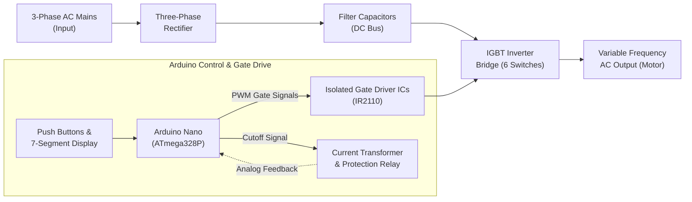
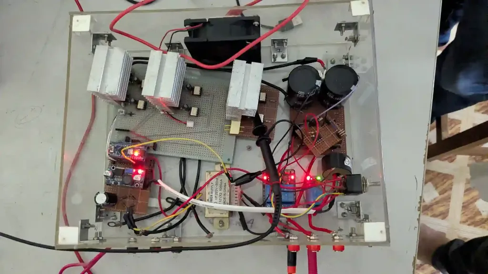
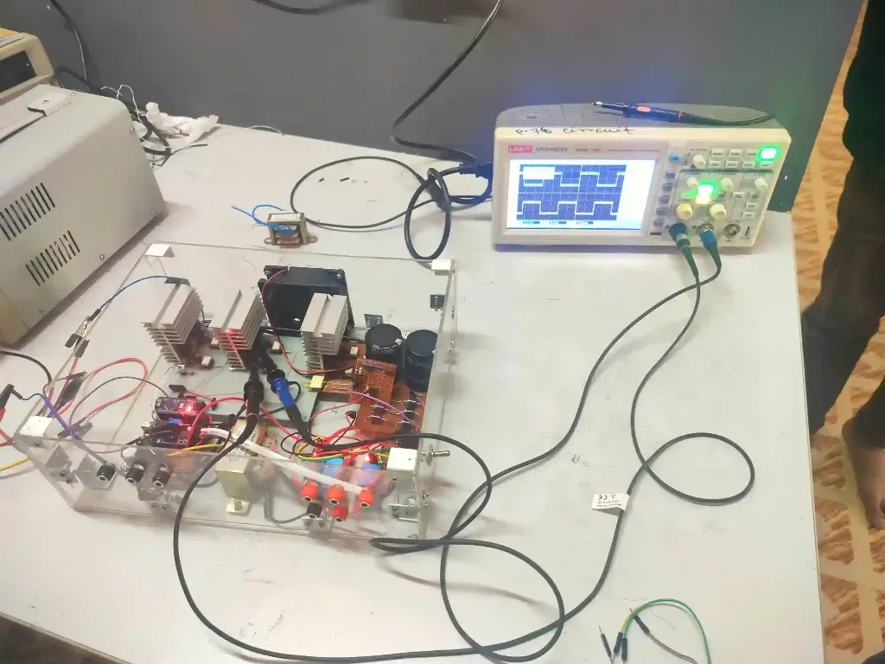
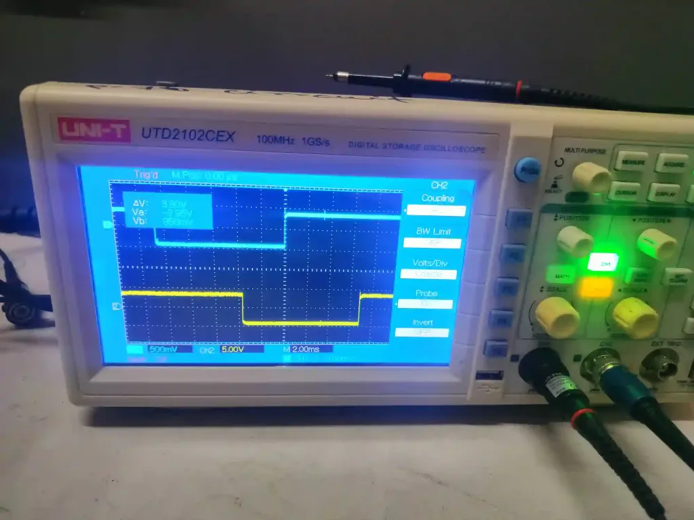
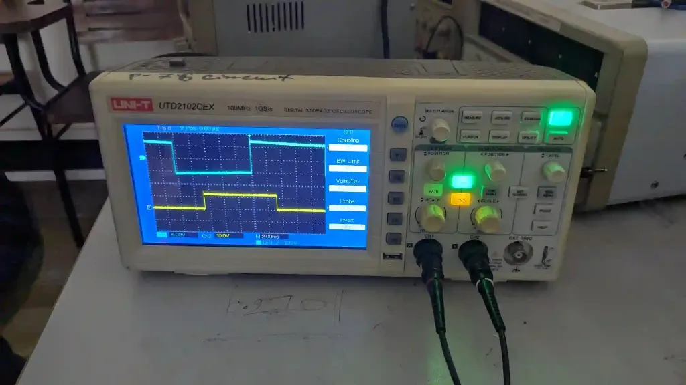
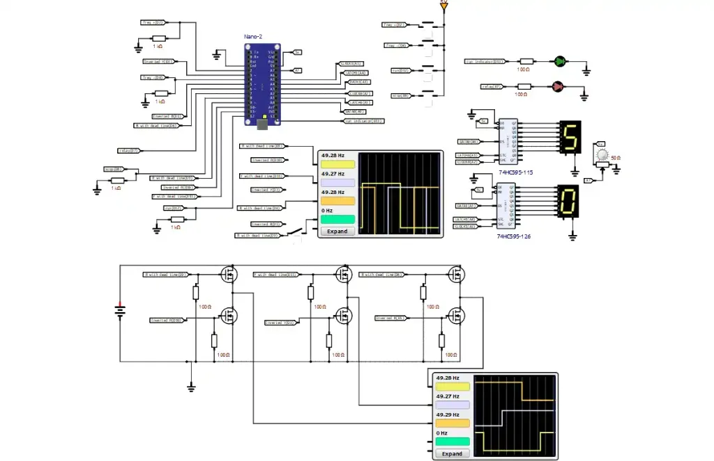

# Three-Phase Inverter System Project

> **Undergraduate EEE Degree — Power Electronics Laboratory Project**  
> *Demonstrating static power conversion, variable frequency drive (VFD) principles, and microcomputer-controlled gate driving using IGBTs and Arduino.*

[](https://github.com/apu-eee-sec/3-phase-vfd)
[-00979D?style=flat&logo=arduino)](https://www.arduino.cc/)
[](https://www.simulide.com/)
[](#power-conversion-process)
[](#key-technical-features)

[View Complete Source Code on GitHub](https://github.com/apu-eee-sec/3-phase-vfd)

---

## Table of Contents
1. [Project Overview](#project-overview)
2. [Power Conversion Process](#power-conversion-process)
3. [Circuit Diagram & System Components](#circuit-diagram--system-components)
4. [Major Components](#major-components)
5. [Control Interface](#control-interface)
6. [Key Technical Features](#key-technical-features)
7. [Arduino Control System & Switching Sequence](#arduino-control-system--switching-sequence)
8. [Complete Arduino Nano Pinout Mapping](#complete-arduino-nano-pinout-mapping)
9. [Protection & Safety Mechanisms](#protection--safety-mechanisms)
10. [Circuit Simulation (SimulIDE)](#circuit-simulation-simulide)
11. [Repository File Structure](#repository-file-structure)
12. [Setup, Compilation & Flashing](#setup-compilation--flashing)
13. [Applications](#applications)

---

## Project Overview

This advanced three-phase inverter system demonstrates power electronics principles using **IGBTs (Insulated Gate Bipolar Transistors)** and **Arduino-based control**. The system efficiently converts three-phase AC input to controlled DC, then back to variable frequency AC output, making it ideal for industrial motor control and variable frequency drive applications.



### Arduino Control System:
* **Generates precise PWM gate signals** for IGBT switching using direct AVR port manipulation.
* **Real-time frequency control** dynamically calculated with sub-microsecond precision.
* **User interface** through responsive push-button controls and dual 7-segment display.

### Applications:
* **Variable Frequency Drives (VFD)** for AC motor speed control
* **Industrial automation** and process control
* **Energy-efficient motor control systems**
* **Power quality improvement** applications
* **Educational demonstrations** of power electronics

---

## Power Conversion Process

The power conversion process proceeds through the following sequential stages:

1. **AC Input:** Three-phase AC power input from mains supply or step-down isolation transformers.
2. **Rectification:** Three-phase diode bridge rectifier converts AC to raw DC:
   $$V_{\text{dc}} \approx \frac{3\sqrt{3}}{\pi} V_{\text{peak, phase}}$$
3. **DC Bus:** Filter capacitors smooth the rectified voltage to maintain a stable, stiff DC voltage for inverter input.
4. **Inversion:** Six-switch IGBT-based bridge inverter converts DC back to controlled three-phase AC.
5. **Output:** Variable frequency and AC output delivered to induction motor windings or test loads.

---

## Circuit Diagram & System Components

The system architecture demonstrates professional power electronics design with proper isolation, protection, and control mechanisms. The modular design allows for easy maintenance and upgrades.

### 1. Complete System Circuit Diagram
The full circuit schematic encompasses the three-phase bridge rectifier, DC bus filter bank, IR2110 gate driver circuits with bootstrap capacitors, six IGBT switches, Arduino Nano microcontroller, dual 7-segment display drivers (74HC595), and overcurrent protection relay:


---

### 2. Hardware Implementation & Physical Layout

| Project Inside (Component & Enclosure Layout) | Laboratory Bench Setup & Oscilloscope Probing |
|:---:|:---:|
|  |  |
| **Project Inside:** Modular acrylic chassis containing the 3 large IGBT heat sinks, 450V DC bus filter capacitors, Arduino Nano control board, isolated gate drive circuitry, current transformer (CT), relay, and cooling fan. | **Laboratory Bench Setup:** Full inverter system under live test, powered and probed by dual-channel UNI-T digital storage oscilloscope (DSO) with AC power supply. |

---

### 3. Laboratory Validation & Oscilloscope Testing

| Single Testing using Oscilloscope | Signal Output in Oscilloscope |
|:---:|:---:|
|  |  |
| **Single Testing using Oscilloscope:** Close-up of DSO channels (CH1/CH2) verifying the gate pulse transition and strict **150 µs dead-time gap** between high-side and low-side switching to eliminate shoot-through. | **Signal Output in Oscilloscope:** Synthesized line-to-line output waveform showing balanced timing, clean transitions, and correct $120^\circ$ phase displacement under variable frequency operation. |

#### Oscilloscope Measurement Summary:
* **Complete System Circuit Diagram:** Verified wiring and isolation safety prior to high-voltage power-up.
* **Single Testing using Oscilloscope:** Analyzed individual gate pulses and validated high-to-low dead-time gap ($150\ \mu\text{s}$) to prevent shoot-through.
* **Project Inside:** Modular board-to-board layout separating high-voltage DC/AC rails from sensitive 5V logic lines.
* **Signal Output in Oscilloscope (Phase-to-Phase):** Verified clean $120^\circ$ phase displacement between line outputs ($V_{RY}$, $V_{YB}$, $V_{BR}$).
* **Signal Output in Oscilloscope (Frequency Scaling):** Observed smooth frequency transitions across the 30 Hz – 70 Hz operating range.
* **Signal Output in Oscilloscope (Dynamic Response):** Confirmed immediate gate cutoff response upon triggering the STOP button or overcurrent relay trip.

---

## Major Components

| Component | Description / Specification | Role in System |
|---|---|---|
| **Arduino Nano** | ATmega328P @ 16 MHz, 5V logic | Main microcontroller for system control and PWM generation |
| **IGBT Modules** | 6x IGBTs configured for 3-phase bridge | High-efficiency power semiconductor switches for 3-phase inversion |
| **Gate Driver ICs** | Isolated gate drivers (e.g., IR2110) | Level-shifting and high-current isolated drive for high/low IGBT gates |
| **Three-Phase Rectifier** | Diode bridge rectifier | Converts incoming 3-phase AC into unregulated DC |
| **Filter Capacitors** | High-voltage electrolytic capacitor bank | DC bus capacitors for voltage smoothing and ripple reduction |
| **Display** | Seven segment display (dual unit via 74HC595) | Real-time monitoring of output frequency (Hz) and current (A) |
| **Push Buttons** | 4x tactile momentary push buttons | User interface for start, stop, and frequency adjustment |
| **Heat Sinks** | Sized extruded aluminum heat sinks | Thermal management and heat dissipation for IGBT modules |
| **Isolation Transformers** | 1:1 safety isolation transformers | Electrical isolation between mains supply and experimental lab setup |

---

## Control Interface

The system features an intuitive control interface with four strategically placed push buttons connected to the Arduino, providing comprehensive control over the inverter operation:

```
+-------------------------------------------------------------+
|                      CONTROL INTERFACE                      |
|                                                             |
|   [ START ]         [ STOP ]        [ FREQ + ]   [ FREQ - ] |
|   (Pin D12)         (Pin D8)         (Pin D2)     (Pin D4)  |
|                                                             |
|   Initiate Power   Safe Shutdown    Increase Freq Decrement |
|   Conversion       Sequence         (Faster)     (Slower)   |
+-------------------------------------------------------------+
```

* **START Button (`Pin D12`):**  
  Initiates the inverter operation and begins the power conversion process. Engages the run indicator LED (`Pin D13`) and enables PWM gating. Also functions as a display mode toggle between frequency (Hz) and current (A).
* **STOP Button (`Pin D8`):**  
  Safely shuts down the inverter with proper sequence control. Immediately drives all gate outputs LOW (`setPinsLow()`) and halts switching.
* **FREQ+ Button (`Pin D2`):**  
  Increases output frequency for higher motor speeds (increments in 1 Hz steps up to 70 Hz). Handled via external hardware interrupt `INT0`.
* **FREQ- Button (`Pin D4`):**  
  Decreases output frequency for lower motor speeds (decrements in 1 Hz steps down to 30 Hz). Handled via pin-change interrupt `PCINT2`.

---

## Key Technical Features

* **IGBT Technology:** High-efficiency switching with low conduction losses, low forward voltage drop, and high thermal ruggedness.
* **PWM Control (Modified Square Wave):** 6-step switching sequence with sub-microsecond timing accuracy via direct AVR port registers (`PORTB`, `PORTD`).
* **Variable Frequency:** Adjustable output frequency from **30 Hz to 70 Hz** (firmware bounds: 10 Hz to 99 Hz).
* **Isolation:** Proper electrical isolation between control and power circuits using isolated gate drivers and isolation transformers.
* **Real-time Control:** Immediate response to user commands via hardware interrupts (`INT0`, `PCINT0`, `PCINT2`).
* **Hardware Dead-Time:** Enforced **150 µs dead-time** between complementary switches in each inverter leg to prevent shoot-through.
* **Overcurrent Protection:** Integrated Current Transformer (CT) on analog pin **A7** with automatic cut-off relay (`Pin D7`) at 6 A.

---

## Arduino Control System & Switching Sequence

### 1. Frequency Calculation Formula
Each electrical cycle of period $T = \frac{1}{f_{\text{out}}}$ is split into six $60^\circ$ conduction steps. A fixed dead-time ($t_{\text{dead}} = 150\ \mu\text{s}$) is subtracted from each $60^\circ$ duration:

$$t_{60^\circ} = \frac{10^6}{6 \cdot f_{\text{out}}} \ [\mu\text{s}], \qquad t_{\text{active}} = t_{60^\circ} - t_{\text{dead}}$$

### 2. Six-Step Conduction Table (180° Inverter Mode)
The firmware executes direct port manipulation for maximum speed and jitter-free switching:

| Step | Angle | Active Switches | Phase R (RH/RL) | Phase Y (YH/YL) | Phase B (BH/BL) |
|:---:|:---:|:---:|:---:|:---:|:---:|
| **1** | $0^\circ - 60^\circ$ | RH, YL, BH | **RH = HIGH** | **YL = HIGH** | **BH = HIGH** |
| **2** | $60^\circ - 120^\circ$ | RH, YL, BL | **RH = HIGH** | **YL = HIGH** | **BL = HIGH** |
| **3** | $120^\circ - 180^\circ$ | RH, YH, BL | **RH = HIGH** | **YH = HIGH** | **BL = HIGH** |
| **4** | $180^\circ - 240^\circ$ | RL, YH, BL | **RL = HIGH** | **YH = HIGH** | **BL = HIGH** |
| **5** | $240^\circ - 300^\circ$ | RL, YH, BH | **RL = HIGH** | **YH = HIGH** | **BH = HIGH** |
| **6** | $300^\circ - 360^\circ$ | RL, YL, BH | **RL = HIGH** | **YL = HIGH** | **BH = HIGH** |

---

## Complete Arduino Nano Pinout Mapping

| Arduino Pin | Port / Bit | Direction | Connected Subsystem / Signal | Description |
|---|---|---|---|---|
| **D2** | `PD2` | INPUT | Push Button: FREQ+ | Hardware External Interrupt `INT0` |
| **D3** | `PD3` | OUTPUT | Inverter Gate: Phase Y Low (`YL`) | Controls Yellow phase lower IGBT |
| **D4** | `PD4` | INPUT | Push Button: FREQ- | Pin-Change Interrupt `PCINT20` (`PCINT2`) |
| **D5** | `PD5` | OUTPUT | Inverter Gate: Phase B Low (`BL`) | Controls Blue phase lower IGBT |
| **D6** | `PD6` | OUTPUT | Inverter Gate: Phase B High (`BH`) | Controls Blue phase upper IGBT |
| **D7** | `PD7` | OUTPUT | Protection Relay Output | HIGH = Armed/Running, LOW = Safe Cutoff |
| **D8** | `PB0` | INPUT | Push Button: STOP | Pin-Change Interrupt `PCINT0` |
| **D9** | `PB1` | OUTPUT | Inverter Gate: Phase R High (`RH`) | Controls Red phase upper IGBT |
| **D10** | `PB2` | OUTPUT | Inverter Gate: Phase R Low (`RL`) | Controls Red phase lower IGBT |
| **D11** | `PB3` | OUTPUT | Inverter Gate: Phase Y High (`YH`) | Controls Yellow phase upper IGBT |
| **D12** | `PB4` | INPUT | Push Button: START / Toggle | Pin-Change Interrupt `PCINT4` (`PCINT0`) |
| **D13** | `PB5` | OUTPUT | Status Indicator LED | Active when inverter is running |
| **A0** | `PC0` | OUTPUT | Display 1: `DATA1` | 74HC595 Serial Data (`DS`) |
| **A1** | `PC1` | OUTPUT | Display 1: `LATCH1` | 74HC595 Storage Clock (`ST_CP`) |
| **A2** | `PC2` | OUTPUT | Display 1: `CLOCK1` | 74HC595 Shift Clock (`SH_CP`) |
| **A3** | `PC3` | OUTPUT | Display 0: `DATA0` | 74HC595 Serial Data (`DS`) |
| **A4** | `PC4` | OUTPUT | Display 0: `LATCH0` | 74HC595 Storage Clock (`ST_CP`) |
| **A5** | `PC5` | OUTPUT | Display 0: `CLOCK0` | 74HC595 Shift Clock (`SH_CP`) |
| **A7** | ADC7 | INPUT | Current Transformer (CT) | Analog input for overcurrent detection |

---

## Protection & Safety Mechanisms

1. **Shoot-Through Prevention (Dead-Time Insertion):**
   * Switching between complementary IGBTs of the same phase leg has a strict **150 µs delay** (`deadtime`), ensuring the outgoing switch turns completely off before the incoming switch turns on.
2. **Overcurrent Sensing (CT + Relay):**
   * A toroidal current transformer samples AC phase current into analog pin `A7`.
   * When measured current exceeds $I_{\text{max}} = 6\ \text{A}$, the system de-energizes `Pin D7`, opening the protection relay and halting PWM.
3. **Galvanic Gate Drive Isolation:**
   * High-voltage floating channels of the IR2110 drivers isolate the logic ground from high-voltage DC bus transients.

---

## Circuit Simulation (SimulIDE)

* **Simulation File:** [`sq.sim1`](./sq.sim1)
* **Simulation Software:** [SimulIDE](https://www.simulide.com/) (Real-time MCU & circuit simulator)

### Simulation Schematic in SimulIDE
The interactive circuit model below incorporates the Arduino Nano, 4 push-button inputs with pull-down resistors, dual 74HC595 shift registers driving dual 7-segment displays (displaying 50 Hz), 3-phase inverter bridge, and virtual oscilloscopes:



### Running the simulation:
1. Open [`sq.sim1`](./sq.sim1) in **SimulIDE**.
2. Right-click the simulated ATmega328P microcontroller and load [`Square_Wave1.ino.eightanaloginputs.hex`](./Square_Wave1/Square_Wave1.ino.eightanaloginputs.hex).
3. Click the **Power** button to start real-time interactive simulation.
4. Observe the synthesized three-phase waveforms on the virtual oscilloscope (`Oscope-243`).

---

## Repository File Structure

```
three-phase-inverter/
├── README.md                      # Comprehensive project documentation
├── vfd circuit diagram.png        # Complete system schematic circuit diagram
├── sq.sim1                        # SimulIDE circuit simulation file
│
├── images/                        # Project photos, simulation & oscilloscope waveforms
│   ├── project-inside-hardware.webp         # Internal hardware layout & components
│   ├── laboratory-bench-testing.webp        # Full bench test setup with oscilloscope
│   ├── oscilloscope-deadtime-testing.webp   # Single testing: dead-time measurement
│   ├── oscilloscope-signal-output.webp      # Inverter output waveform measurement
│   └── simulide-simulation-schematic.webp   # SimulIDE interactive schematic
│
├── Square Wave/                   # Prototype 1 implementation
│   ├── Circuit connection.jpg     # Hardware setup & oscilloscope test photo
│   ├── square3p_deadtimewhile.ino # Gating pulse generator with dead-time
│   ├── pinconfig.ino              # Port register initialization
│   ├── segment.ino                # 7-segment display driver
│   ├── btn.ino                    # Button interrupt routines
│   ├── adjust_freq.ino            # Frequency math conversion
│   └── *.hex                      # Pre-compiled firmware binaries
│
├── Square_Wave1/                  # Prototype 2 with CT sensing
│   ├── Square_Wave1.ino           # Main program
│   ├── CT.ino                     # Current transformer sampling routines
│   └── *.ino                      # Modular drivers
│
└── Square_Wave2/                  # Production firmware (Latest & Recommended)
    ├── Square_Wave2.ino           # Master loop and interrupt initialization
    ├── square.ino                 # 6-step switching state machine
    ├── pinconfig.ino              # Register-level I/O configuration
    ├── btn.ino                    # External & pin-change ISR handlers
    ├── CT.ino                     # ADC register sampling & overcurrent cutoff
    ├── segment.ino                # Dual 74HC595 shift register multiplexer
    └── adjust_freq.ino            # Real-time frequency recalculation
```

---

## Setup, Compilation & Flashing

1. **Prerequisites:** Install [Arduino IDE](https://www.arduino.cc/en/software) (v1.8+ or v2.x).
2. **Open Firmware:** Open [`Square_Wave2/Square_Wave2.ino`](./Square_Wave2/Square_Wave2.ino).
3. **Select Board:** `Tools` $\to$ `Board` $\to$ `Arduino Nano`.
4. **Select Processor:** `Tools` $\to$ `Processor` $\to$ `ATmega328P` (or `ATmega328P (Old Bootloader)`).
5. **Upload:** Connect USB cable, select COM port, and click **Upload**.

---

## Applications

* **Variable Frequency Drives (VFD)** for motor speed control
* **Industrial automation** and process control
* **Energy-efficient motor control systems**
* **Power quality improvement** applications
* **Educational demonstrations** of power electronics

---

## Project Source Code

The complete source code, hardware diagrams, and simulation files are accessible on GitHub:

🔗 **[View Complete Source Code on GitHub](https://github.com/apu-eee-sec/3-phase-vfd)**

---

*Submitted as part of the Undergraduate B.Sc. in Electrical & Electronic Engineering (EEE) degree curriculum — Power Electronics Laboratory.*
